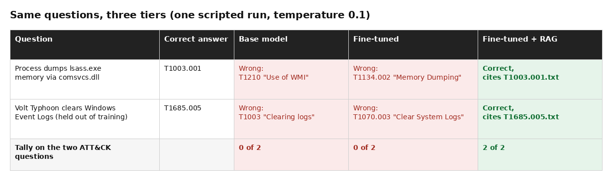
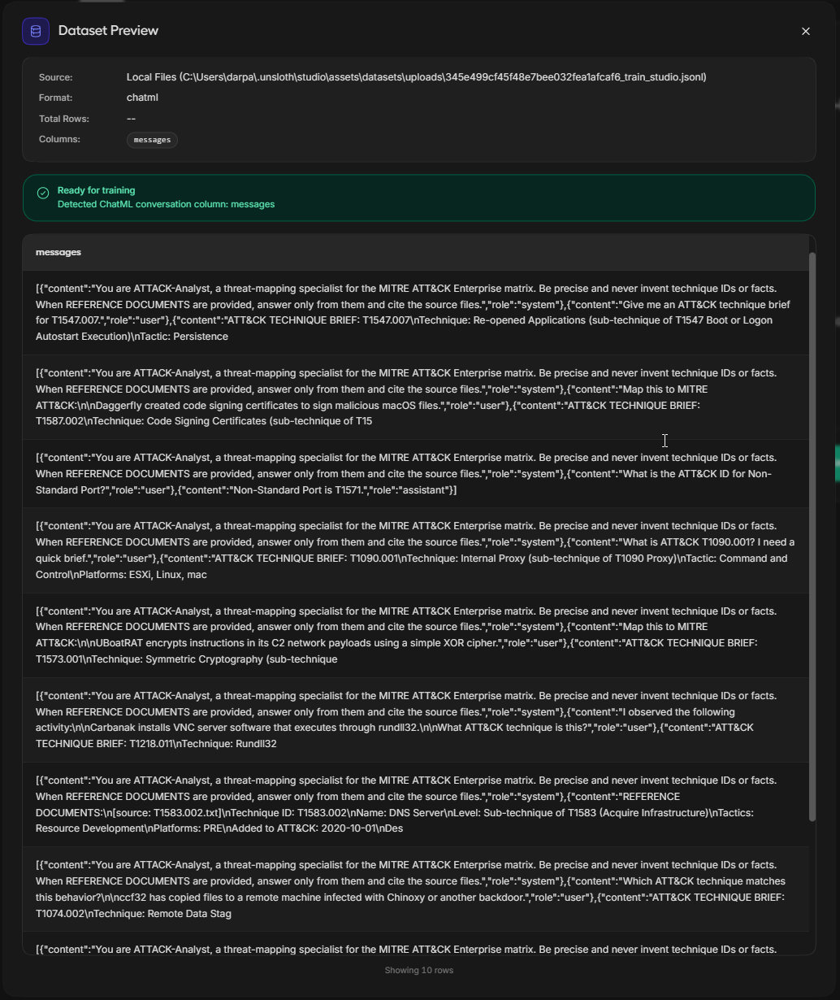
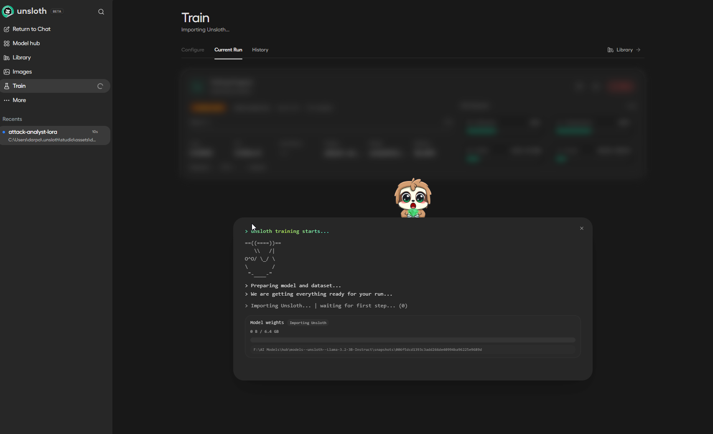
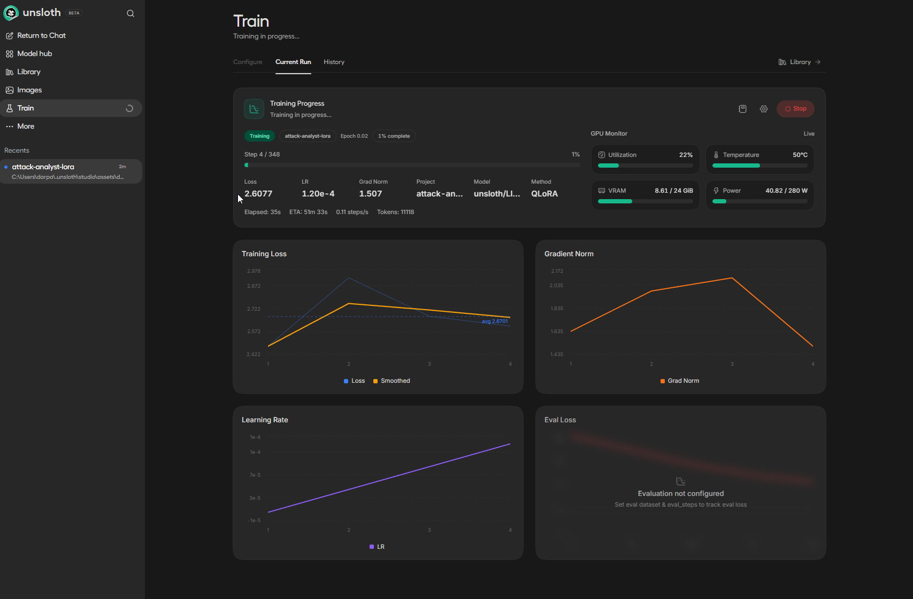
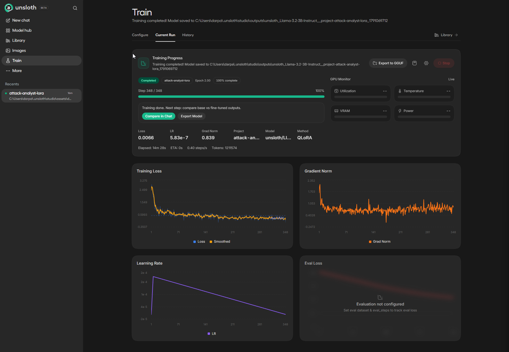
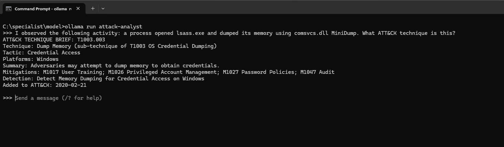
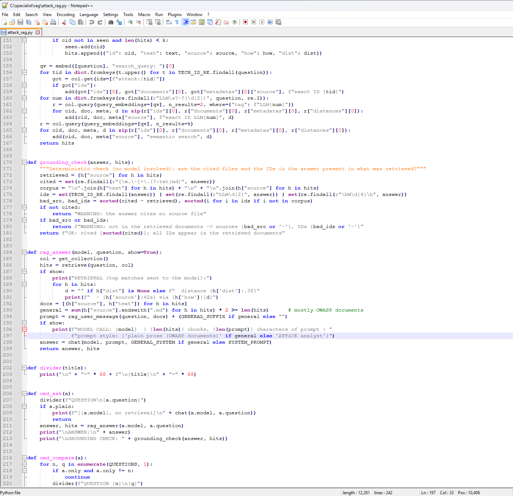
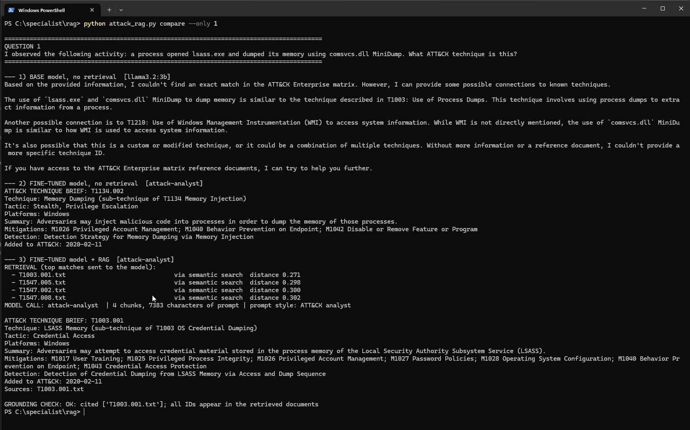
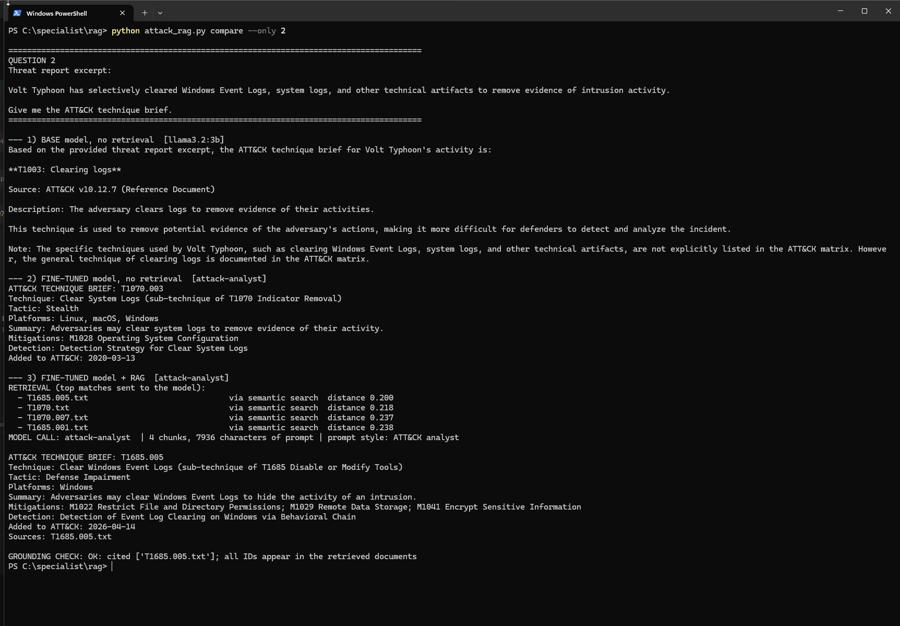
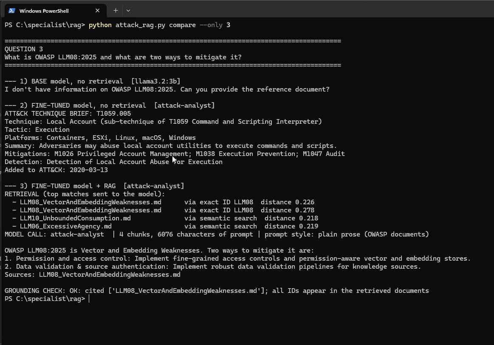

# ATTACK-Analyst

A small, local threat-mapping assistant for the MITRE ATT&CK Enterprise matrix, built to answer one question: **what does fine-tuning add to a 3B model, what does RAG add on top, and when should you use each?**

> Fine-tuning changed how the model answered. RAG changed whether the answer was true.

This is Assignment 1 of The Cyber Instructor's AI/ML for cybersecurity bootcamp. The full walkthrough, with the story and the screenshots, is on Medium:
[ATTACK-Analyst: Fine-Tuning Made a 3B Model Sound Right. RAG Made It Right.](https://medium.com/@darpanvedi0/attack-analyst-fine-tuning-made-a-3b-model-sound-right-rag-made-it-right-8e4ad935ea84)

## The result in one picture



On two ATT&CK questions, the base model and the fine-tuned model each got 0 of 2. Fine-tuned plus RAG got 2 of 2, including a technique that was held out of training. A third question, about OWASP LLM08:2025, was also answered correctly with retrieval.

**Read this as a three-question demonstration on a 3B model, not a benchmark.** Outputs also vary a little from run to run, even at low temperature, so the exact wrong IDs in the screenshots are one run, not a fixed result.

## What is in the repo

| Path | What it is |
|---|---|
| `src/build_dataset.py` | Downloads ATT&CK, splits it by date, builds the chat-format training data |
| `src/attck_common.py` | Shared helpers, so training prompts, RAG documents and the RAG prompt stay identical |
| `src/attack_rag.py` | The RAG pipeline: ingest, hybrid retrieval, model call, grounding check, 3-tier comparison |
| `ollama/Modelfile` | Serves the fine-tuned GGUF in Ollama with the Llama 3 template and temperature 0.1 |
| `training/unsloth_studio_settings.md` | The exact training settings, so the run can be repeated |
| `notes/reflection.md` | What fine-tuning added, what RAG added, and when to use each |
| `assets/` | Screenshots from the run |

## How it works

1. **Split by date.** ATT&CK v19.2 has 697 techniques and sub-techniques. The 609 created up to 2023-12-31 are the training set. The 88 newer ones are held out on purpose, so the model has never seen them and only RAG can supply them. A check in the build script fails if any held-out ID appears in the training text.
2. **Fine-tune.** 1,385 conversations in four kinds: `brief` (the fixed analyst brief), `fact` (short single-fact answers), `open_book` (documents in the prompt, answer must cite the source file) and `abstain` ("not in the provided documents"). Llama-3.2-3B-Instruct, QLoRA, trained in Unsloth Studio.
3. **Serve.** Export a Q8_0 GGUF and run it through Ollama as `attack-analyst`.
4. **Add RAG.** ChromaDB with `nomic-embed-text`. 757 chunks: 697 ATT&CK technique documents plus 60 sections of the OWASP Top 10 for LLM Applications 2025, which the model never saw in training. Retrieval looks up exact IDs first (`T1059.001`, `LLM08`), then fills the rest with semantic search, top 4.
5. **Check the citations.** A plain-code grounding check (no model involved) tests whether the files and IDs cited in an answer actually appear in the retrieved documents, and prints a warning if not.

## Run it

You need [Ollama](https://ollama.com), Python 3.10 or newer, and a way to fine-tune (the run here used Unsloth Studio).

```bash
git clone https://github.com/darpanvedi0/attack-analyst
cd attack-analyst
pip install -r requirements.txt

# 1. Build the dataset (about 50 MB download, one time)
python src/build_dataset.py
# -> data/train_studio.jsonl is the file to upload into Unsloth Studio
```

2. Fine-tune with the settings in [`training/unsloth_studio_settings.md`](training/unsloth_studio_settings.md), then export a **Q8_0 GGUF**.

```bash
# 3. Serve the fine-tuned model
cp /path/to/Llama-3.2-3B-Instruct.Q8_0.gguf ollama/
cd ollama && ollama create attack-analyst -f Modelfile && cd ..

# 4. Models used by the RAG script
ollama pull llama3.2:3b          # the base model, for the comparison
ollama pull nomic-embed-text     # the embedding model

# 5. Build the document store, then ask questions
python src/attack_rag.py ingest
python src/attack_rag.py ask "A process opened lsass.exe and dumped its memory using comsvcs.dll MiniDump. What ATT&CK technique is this?"
python src/attack_rag.py ask "..." --plain     # same model, no retrieval
python src/attack_rag.py compare               # the 3 test questions through base / fine-tuned / fine-tuned + RAG
```

Run every command from the repository root. The scripts write `data/`, `docs/` and `rag_db/` there, and all three are git-ignored. The dataset step is deterministic: with ATT&CK v19.2 it reproduces the exact training file used for this project. ATT&CK keeps changing, so a newer release will give different numbers.

## Screenshots from the run

| | |
|---|---|
|  |  |
|  |  |
|  |  |
|  |  |
|  | |

The three Unsloth Studio comparison screenshots (`assets/06_` to `assets/08_`) come from a separate run from the scripted scoreboard, so the wrong IDs differ between them. Every answer without retrieval was wrong in both.

## What I learned

- Fine-tuning taught the model **format**: the same structured brief every time, and the habit of citing a source file. It did not teach reliable **facts**. It confidently named techniques that do not exist.
- Fine-tuning also **over-specialized** the model. Asked about OWASP LLM08:2025, it printed an ATT&CK-style brief with made-up content, even when the right OWASP text had been retrieved. The pipeline works around this with a plain-prose prompt for OWASP documents. The proper fix is more varied training data.
- RAG supplied the **facts at question time**, with citations that can be checked, and updating means re-indexing instead of retraining.
- The training loss ended very low (0.0066 at step 348). That fits a model memorizing the answer format, and it is a reminder that a low loss does not mean the facts are right.

More in [`notes/reflection.md`](notes/reflection.md).

## Limits

- Three questions, one model size, low temperature. This is a demonstration of a pattern, not a measurement.
- Retrieval is not perfect. A missed document produces a wrong answer or an abstention.
- The fine-tune was short (2 epochs). A longer or more varied run might memorize more facts, but RAG would still be the better place for facts that change.
- The grounding check confirms that cited files and IDs were retrieved. It does not prove the answer is correct, so verify against the cited source.

## Credits and licenses

- Code in this repository: MIT, see [LICENSE](LICENSE).
- MITRE ATT&CK is a registered trademark of The MITRE Corporation. ATT&CK data is used under the [ATT&CK terms of use](https://attack.mitre.org/resources/legal-and-branding/terms-of-use/) and is downloaded at build time, not redistributed here.
- The OWASP Top 10 for LLM Applications 2025 is from the OWASP GenAI Security Project and is downloaded at ingest time. Check its repository for the current license terms.
- The base model, Llama-3.2-3B-Instruct, is governed by the Llama 3.2 Community License. No model weights are included in this repository.
- Built with [Unsloth](https://github.com/unslothai/unsloth), [Ollama](https://ollama.com), [ChromaDB](https://www.trychroma.com) and `nomic-embed-text`.

Thanks to Karan Dwivedi, Apurv Singh Gautam and The Cyber Instructor for the assignment.
